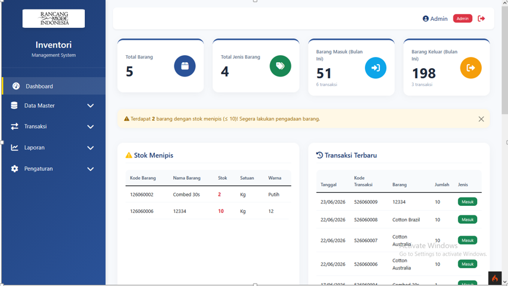
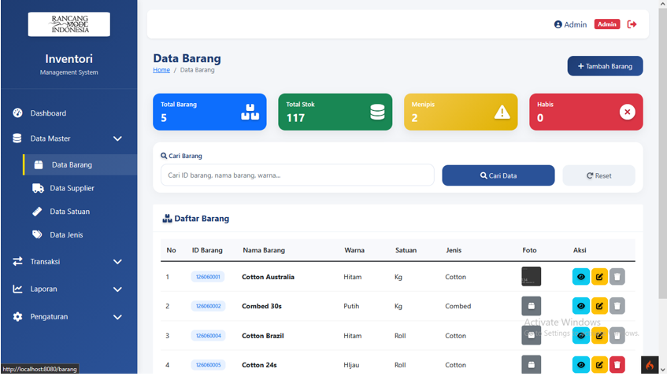
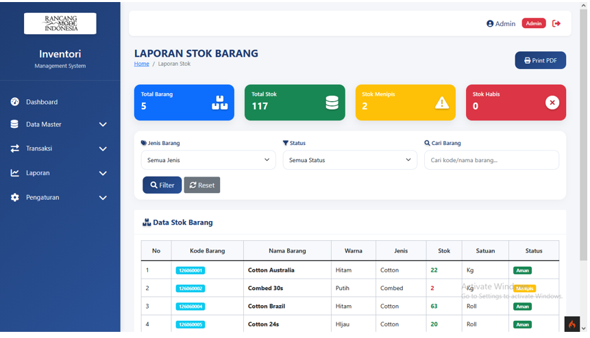

# 📦 Sistem Informasi Inventori Barang

Aplikasi web manajemen inventori untuk mencatat data barang, transaksi barang masuk dan keluar, memantau stok, serta menghasilkan laporan. Dilengkapi hak akses berdasarkan peran pengguna.

Dibangun dengan **CodeIgniter 4**, **Bootstrap 5**, dan **Chart.js**.

---

## 📸 Preview Aplikasi

### Dashboard
<p align="center">
  
</p>

### Data Barang
<p align="center">
  
</p>

### Laporan
<p align="center">
  
</p>

---

## ✨ Fitur Utama

- **Dashboard**: ringkasan total barang, total jenis barang, serta barang masuk dan keluar bulan berjalan.
- **Peringatan stok**: notifikasi untuk stok menipis (≤ 10) dan stok habis.
- **Grafik 7 hari terakhir**: tren barang masuk dan barang keluar.
- **Top 5 stok**: barang dengan stok terbanyak dan tersedikit.
- **Transaksi terbaru**: daftar transaksi masuk dan keluar terakhir.
- **Data Master**: pengelolaan barang, supplier, satuan, dan jenis barang.
- **Transaksi**: pencatatan barang masuk dan barang keluar.
- **Laporan**: laporan stok, laporan barang masuk, dan laporan barang keluar.
- **Manajemen User**: pengelolaan akun pengguna.
- **Hak akses berdasarkan peran**: tampilan menu menyesuaikan level pengguna.
- **Tampilan responsif**: sidebar menyesuaikan ukuran layar.

---

## 👥 Peran Pengguna

| Menu | Admin | Staff Gudang | Owner |
|---|:---:|:---:|:---:|
| Dashboard | ✅ | ✅ | ✅ |
| Data Master | ✅ | ❌ | ❌ |
| Barang Masuk | ✅ | ❌ | ❌ |
| Barang Keluar | ✅ | ✅ | ❌ |
| Laporan Stok dan Laporan Masuk | ✅ | ❌ | ✅ |
| Laporan Keluar | ✅ | ✅ | ✅ |
| Manajemen User | ✅ | ❌ | ❌ |

---

## 🛠️ Teknologi

| Teknologi | Kegunaan |
|---|---|
| PHP 8.2+ | Bahasa pemrograman backend |
| CodeIgniter 4 | Framework aplikasi web |
| MySQL | Basis data |
| Bootstrap 5 | Tata letak dan komponen UI |
| Font Awesome | Ikon |
| Chart.js | Grafik di dashboard |
| Composer | Manajemen dependensi PHP |
| Git | Version control |

---

## 🚀 Instalasi dan Menjalankan Proyek

### Prasyarat
- PHP 8.2 atau lebih baru (aktifkan ekstensi `intl`, `mbstring`, `mysqlnd`, dan `curl`)
- Composer
- MySQL atau MariaDB
- Koneksi internet (Bootstrap, Font Awesome, dan Chart.js dimuat lewat CDN)

### 1. Clone repository

```bash
git clone <URL_REPOSITORY>
cd <NAMA_FOLDER_PROYEK>
```

### 2. Instal dependensi

```bash
composer install
```

### 3. Siapkan environment

CodeIgniter 4 menyediakan file contoh bernama `env`. Salin menjadi `.env`:

```bash
cp env .env
```

Pada Windows, salin file `env` secara manual lalu ganti namanya menjadi `.env`.

### 4. Konfigurasi `.env`

Atur URL aplikasi dan database:

```dotenv
CI_ENVIRONMENT = development

app.baseURL = 'http://localhost:8080/'

database.default.hostname = localhost
database.default.database = nama_database
database.default.username = root
database.default.password =
database.default.DBDriver = MySQLi
```

Buat database kosong dengan nama yang sama di MySQL.

### 5. Siapkan tabel database

Pilih salah satu sesuai yang tersedia di proyek:

```bash
php spark migrate
```

atau impor file SQL (misalnya dari folder `database/`) melalui phpMyAdmin.

Jika proyek menyediakan seeder untuk akun awal:

```bash
php spark db:seed NamaSeeder
```

### 6. Jalankan aplikasi

```bash
php spark serve
```

Buka `http://localhost:8080` di browser.

---

## 📂 Struktur Proyek

```text
├── app/
│   ├── Config/
│   ├── Controllers/
│   ├── Models/
│   └── Views/
│       └── layout/
│           ├── sidebar.php
│           └── footer.php
├── public/
│   └── assets/
│       └── images/
│           └── logo.png
├── docs/
│   └── screenshots/
├── writable/
├── env
├── composer.json
└── README.md
```

---

## 🔒 Keamanan

- Jangan mengunggah file `.env` ke repository publik.
- Jangan menyimpan password database atau kunci rahasia di dokumentasi.
- Batasi akses halaman berdasarkan peran di sisi server (filter pada route), bukan hanya dengan menyembunyikan menu.
- Gunakan `esc()` pada data yang ditampilkan di view untuk mencegah XSS.
- Ganti password akun awal setelah instalasi.

---

## 🗺️ Rencana Pengembangan

- Filter akses per peran pada route.
- Ekspor laporan ke PDF dan Excel.
- Pencarian dan paginasi pada tabel data.
- Pengujian otomatis untuk fitur penting.
- Deployment agar aplikasi dapat diakses online.

---

## 👨‍💻 Developer

**Muhamad Zul Sa'ban**

- GitHub: [@muhamadzulsaban](https://github.com/muhamadzulsaban)